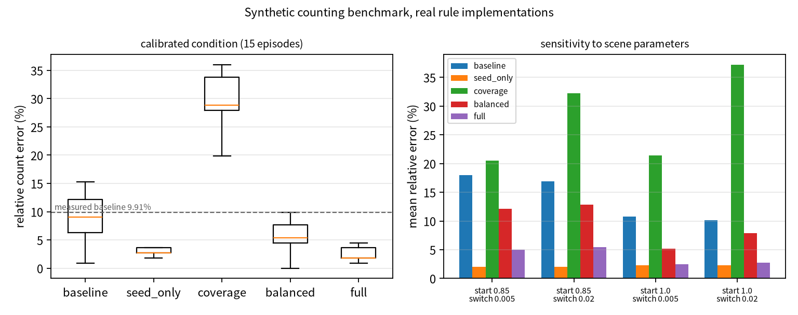

# CountVid 晶体计数：性能改进方案（v2）

本文记录在 [ikunmai/cv_project](https://github.com/ikunmai/cv_project) 现有代码上做的改进、可复现的验证结果，以及在 GPU 上测量真实提升的步骤。原有脚本、原有结果和 [REPRODUCE_zh.md](REPRODUCE_zh.md) 记录的单视频结果**没有被修改**，基线仍可原样复现。

---

## 0. 把改动拿到你的机器上

三种方式任选，效果相同（都是 12 个文件：10 个新增、2 个修改）。

**方式 A：打成补丁（推荐，保留提交信息）**

```bash
cd cv_project                      # 你们自己的克隆
git checkout -b improve/counting-v2
git am counting-v2.patch           # 交付的补丁文件
git push -u origin improve/counting-v2
```

**方式 B：直接解压覆盖**

```bash
cd cv_project
tar xzf cv_project_v2_overlay.tar.gz     # 解压到仓库根目录，只覆盖新增/修改的文件
```

**方式 C：只要新增文件**

`cv_project_v2_overlay.tar.gz` 里不含原有脚本，原有三个计数脚本在任何方式下都不会被改动；`count_in_videos_pseudo_exemplars.py` 仍是基线，`--profile baseline` 用于复现。

拿到代码后，先跑一次单测（不需要 GPU 和数据）：

```bash
python -m pytest tests/ -q      # 应为 20 passed
```

然后按第 6 节在 GPU 上测真实效果。

---

## 1. 结论摘要

- 现有流程在晶体视频上**系统性少计**（ma2035_023：100 vs 111）。原因不在 CountGD 本身：在 37 帧里几乎每颗晶体都至少被检测到一次；少计来自第 3 阶段的**新物体判据过严**（要求新框与所有已跟踪掩码**零像素重叠**），以及**只在第一帧建立初始轨迹**。
- v2 的做法：把计数决策从流水线里抽出来，做成可配置、可单测、可离线回放的规则模块，并提供 4 个可选改进：
  1. **覆盖率新物体判据**：候选掩码至少有 50% 面积未被已跟踪掩码覆盖就接纳（替代"零重叠"）；
  2. **轨迹合并**：传播结束后把重复轨迹（共视高 IoU、或一条轨迹消失后另一条在同一位置出现）用并查集合并；
  3. **在检测最多的帧建立初始轨迹，并向回传播**（晶体是逐渐长大变清楚的，第一帧通常最差）；
  4. **多样性伪示例**：按空间网格分散挑选伪示例，避免 10 个示例全落在最显眼的同一片区域。
- 同时修掉了一个**确定的 bug**：一帧内新增物体超过 `--obj_batch_size`（默认 30）时，分支 A 的第 2 批会重复提交第 1 批的框，导致"重复轨迹 + 漏掉真正的物体"。
- 掩码比较换成向量化实现，时序过滤的成对 IoU 计算在本机微基准上快 **20–24 倍**（数值完全一致，单测覆盖）；轨迹合并、覆盖率判据本身是毫秒级。
- 在**按已测单视频校准的合成基准**上（基线复现出 8.9% 相对误差，实测 9.91%），两项改动分别把相对误差降到：
  - **只在检测最多的帧建轨迹 + 双向传播**（`seed_only`）：**2.7%**（MAE 9.9 → 3.0），且对场景参数几乎不敏感（扫描中 2.0–2.3%）；
  - **再加覆盖率判据与轨迹合并**（`full`）：**2.5%**（MAE 2.7），但在"对象陆续出现"的场景里退化到 ~5%。

  也就是说，**单项收益最大、最稳的改动是种子帧**；合并与覆盖率判据是可选的第二步。以上都是机制验证，**不是**基准测试结果，真实数字必须用 `replay_crystals.py` 在你们冻结的中间结果上跑。

> 重要：本机没有 GPU、没有 CountGD / SAM 2 权重、也没有 VideoCount 数据（GitHub、Google Drive、HuggingFace 均不可达），所以**没有做端到端实测**。下面第 5 节写清楚了哪些是实测、哪些是仿真，第 6 节给出了在你们的 5070 Ti 上得到真实数字的完整步骤（一次全量运行 + 之后秒级/分钟级的规则扫描）。

---

## 2. 诊断：少计与多计分别来自哪里

以 `count_in_videos_pseudo_exemplars.py` 为准（行号对应该文件）。

### 2.1 只从第一帧建立轨迹

第 1004–1041 行：`i` 取"第一个有检测的帧"（通常就是第 0 帧），只把这一帧的框作为 SAM 2 提示传播到全视频，得到集合 `T`。之后每帧只能通过分支 A 追加新物体。

晶体视频里对象是随时间出现、长大的。第一帧检测到的对象最少，**后面帧新出现/才被看清的对象，全部依赖分支 A 的准入判据**。

### 2.2 "零重叠"判据在密集场景几乎必然拒绝正确的新物体

第 783 行：

```python
if len(obj_mask) >= args.min_obj_area and (len(obj_mask & combined_obj_masks) == 0):
```

新候选掩码必须与**该帧所有已跟踪掩码的并集没有任何一个共享像素**。SAM 的掩码偏"胖"、晶体彼此紧挨，候选掩码几乎总会蹭到邻居几个像素——哪怕它 95% 的面积是全新的，也会被丢弃。`--min_obj_area` 默认 0，起不到第二道筛选作用。

这条规则的设计意图是防止重复计数（同一个物体再次被判成新物体），代价是在密集场景里牺牲召回。它也是"阈值质量筛选越严格、结果越差"（98 vs 100）的原因：提高伪示例门槛只会让检测更少，而准入规则并不会因此放松。

### 2.3 重复轨迹没有任何清理

`T` 的每个键就是一次计数。传播漂移、身份换到邻居、遮挡后重新检测，都会产生描述**同一个晶体**的第二条轨迹。v1 没有任何轨迹级去重，重复与漏检互相抵消，最后误差方向取决于视频内容——ma2035_023 是漏检占上风（-11）。

### 2.4 分支 A 的批偏移 bug

第 1055–1056 行：

```python
for ind in range(min(args.obj_batch_size, len(new_box_prompts) - batch_ind * args.obj_batch_size)):
    box = new_box_prompts[ind]
```

`ind` 每批都从 0 开始，没有加 `batch_ind * obj_batch_size`。当某帧新增物体多于 30 个时，第 2 批会把第 1 批的前若干个框**再添加一遍**（生成重复轨迹），同时真正的第 31 个以后的物体永远不会被加入。单测 `test_branch_a_batch_offset_is_fixed` 复现了这个问题。

### 2.5 伪示例全部取最高分框

`get_pseudo_exemplars` 只按分数排序取前 10 个。密集场景里最高分的框往往聚集在同一片最清晰、最容易的区域，示例集对"外观多样性/空间覆盖"没有约束。而且示例每帧都从**当前帧自己的输出**重新生成（自反馈），一旦某一帧漏检，示例集也会跟着收缩。

### 2.6 掩码 IoU 用 Python 集合逐对求交

`check_obj_persistence` / `compute_iou`（第 526 行起）把掩码转成 `set(zip(rows, cols))`，再对"每个物体 × 每个邻居帧 × 该帧每个物体"做集合交并。`get_new_objs` 也是同样的写法。这是纯 CPU 开销，且是平方复杂度。

---

## 3. 改动清单

新增文件（原有计数脚本一行未改，只更新了 `.gitignore` 和复现文档的入口）：

| 文件 | 作用 |
|---|---|
| `counting_rules.py` | 规则核心，纯 NumPy：快速掩码 IoU / 覆盖率索引、新物体判据、轨迹合并、`track_and_count`（第 3 阶段全流程，传播通过回调注入）、多样性伪示例选择、配置与 profile |
| `counting_cache.py` | 把第 1/2 阶段的逐帧框和掩码存成 npz，供离线回放 |
| `count_in_videos_pseudo_exemplars_v2.py` | 升级版计数脚本：接入上面的规则模块和缓存，新增 `--profile` 等参数；默认参数等价于 v1（除 bug 修复外） |
| `replay_crystals.py` | 只跑第 3 阶段的规则扫描：多配置 × 多视频 → CSV + MAE/NAE 表，支持留一视频选择配置 |
| `run_crystals_v2.py` | 与 `run_crystals_single_quality.py` 同样的实验记录方式（settings/metrics/run.log），支持全量视频与 `--save_cache` |
| `simulate_video_counting.py` | 校准过的合成计数基准，直接调用 `counting_rules.track_and_count` |
| `bench_mask_ops.py` | 掩码运算微基准（原始集合实现 vs 向量化实现） |
| `tests/test_counting_rules.py` | 20 个单测，含"与原始实现数值一致""分支 A bug 复现""覆盖率判据在密集场景多找到物体"等 |

### 3.1 配置 profile

`counting_rules.PROFILES` 里定义了：

| profile | 新物体判据 | 轨迹合并 | 种子帧 / 方向 |
|---|---|---|---|
| `baseline` | strict（零重叠，等同 v1） | 否 | 第一帧 / 正向 |
| `seed_only` | strict | 否 | 检测最多的帧 / 双向 |
| `coverage` | coverage，uncovered ≥ 0.5 | 否 | 第一帧 / 正向 |
| `balanced` | coverage 0.5 | 是（共视 IoU ≥ 0.5，≥2 帧） | 第一帧 / 正向 |
| `recall` | coverage 0.35 + handover 合并 | 是（IoU ≥ 0.45） | 第一帧 / 正向 |
| `full`（推荐） | coverage 0.5 | 是（IoU ≥ 0.55） | 检测最多的帧 / 双向 |

单个参数都可以在命令行覆盖，例如：

```bash
--rule coverage --min_uncovered 0.45 --merge_tracks --merge_iou 0.6 \
--seed_policy most_detections --bidirectional
```

### 3.2 默认行为仍然是 v1

`--profile` 缺省为 `baseline`（strict、不合并、第一帧种子、正向传播、伪示例 top-k）。除了一处 bug 修复（2.4）、掩码 IoU 的实现替换（数值一致，有单测）以及多出来的日志，基线的计数结果与原脚本相同。想逐位复核，可以先用 `--profile baseline --save_cache` 跑一遍，与团队此前保存的 predicted.json 对照。

---

## 4. 改动后的变量与语义

- 第 3 阶段完全由 `counting_rules.track_and_count` 实现，逻辑与 v1 逐步对应（初始化 → 种子传播 → 逐帧找未被覆盖的独立掩码 → 分支 A 传播），只是判据可换、批偏移修正、结束后可合并去重。
- `T` 仍然是"轨迹 → 每帧掩码"的字典，`num_objects = len(T)`，输出 JSON、评估脚本、可视化都不变。
- 合并只在**传播结束后**进行，不改变 SAM 2 的输入，因此和 v1 的差异只来自"哪些物体被接纳为轨迹"和"哪些轨迹被合并"。

---

## 5. 验证结果

### 5.1 单元测试（实测）

```bash
python -m pytest tests/ -q      # 20 passed
```

关键用例：

- `test_strict_rule_matches_original`：在 30 组随机掩码上，新实现选出的"新物体"下标与原 `get_new_objs` **完全一致**（基线等价性）；
- `test_iou_matches_original`：向量化 IoU 与原集合实现在 50 组随机掩码上误差 < 1e-12；
- `test_track_and_count_matches_original_loop`：在玩具视频上，`track_and_count(baseline)` 与原第 3 阶段循环得到相同的轨迹集合；
- `test_branch_a_batch_offset_is_fixed`：`obj_batch_size=2`、一帧新增 5 个物体时，原实现计数偏大，新实现正好 6 条轨迹；
- `test_coverage_rule_admits_occluded_but_not_duplicate`：与已跟踪掩码重叠 25% 的新物体被 coverage 接纳、被 strict 拒绝；重叠 64% 的重复框被拒绝。

### 5.2 校准仿真（机制验证，不是基准结果）

`simulate_video_counting.py` 生成 111 个随时间出现、长大的晶体，CountGD 检测概率随物体大小上升（小物体更易漏），SAM 掩码偏胖且邻居互相重叠，视频传播会漂移/换到邻居/丢失，再接上时序过滤；然后把**真实的** `counting_rules.track_and_count` 跑在上面。`detect_floor=0.365` 是唯一用来校准的参数，校准目标是团队实测的 ma2035_023 结果。

15 个随机种子，gt = 111：

| profile | 平均计数 | 偏差 | MAE | RMSE | NAE | 平均合并轨迹数 |
|---|---:|---:|---:|---:|---:|---:|
| baseline | 101.3 | −9.7 | 9.87 | 10.91 | 8.89% | 0 |
| **seed_only** | 114.0 | +3.0 | **3.00** | **3.15** | **2.70%** | 0 |
| coverage | 144.7 | +33.7 | 33.67 | 34.24 | 30.33% | 0 |
| balanced | 104.5 | −6.5 | 6.47 | 7.11 | 5.83% | 40.1 |
| **full** | 108.5 | −2.5 | **2.73** | **2.98** | **2.46%** | 13.7 |

参考量：第一帧平均检测到 95.7 个物体，检测最多的一帧平均 114.2 个，111 个物体在整段视频里都至少被检测到一次。也就是说，**检测本身的上限是 111，基线的 9.9 个误差是方法造成的，不是检测能力造成的**。



（左图：校准条件下 15 次的相对误差分布，虚线为团队实测的 9.91%；右图：场景参数敏感性。）

敏感性（平均 NAE，每个条件 4 次）：

| profile | start 0.85 / switch 0.005 | 0.85 / 0.02 | 1.0 / 0.005 | 1.0 / 0.02 |
|---|---:|---:|---:|---:|
| baseline | 18.02% | 16.89% | 10.81% | 10.14% |
| **seed_only** | **2.03%** | **2.03%** | **2.25%** | **2.25%** |
| coverage | 20.50% | 32.21% | 21.40% | 37.16% |
| balanced | 12.16% | 12.84% | 5.18% | 7.88% |
| full | 4.95% | 5.41% | 2.48% | 2.70% |

诚实地读这张表：

- **只改新物体判据（coverage）是有害的**：它把大量重复轨迹当成新物体，NAE 从 9–18% 涨到 20–37%。它必须和轨迹合并一起用（`balanced`）。
- **"检测最多的帧 + 双向传播"是单项收益最大的改动**：校准条件下 8.9% → 2.7%，而且四个敏感性条件都在 2.0–2.3%，几乎不受场景参数影响。它只改了一个决策（种子帧），解释和调试都最简单。
- **完整 profile** 在校准条件下略好（2.5%），但在"对象陆续出现"（start 0.85）的场景里退化到 ~5%：这时种子帧已经包含了全部对象，覆盖率判据和合并反而引入误差。
- 因此推荐顺序是：先试 `seed_only`，确认它在你视频上有效；再试 `full`，用真实数据决定。不要把 `full` 当作"一定更好"的默认值。
- 仿真里的绝对数值依赖场景假设（覆盖率 0.75、漂移/换目标概率等），**只能用来判断方向与相对排序**，不能当作晶体数据集的分数。

### 5.3 计算开销（实测）

`bench_mask_ops.py`，1080p 帧、100 个物体、5 帧（接近晶体视频的规模与时序过滤的访问模式）：

```
pairwise IoU (temporal filter, w=3): original 3.48s  fast 0.14s  speedup 24.1x
get_new_objs:                        original 0.021s fast 0.013s
merge_tracks on 100 tracks:          0.04s
```

（物体数越多，原始实现的平方复杂度越吃亏；60 个物体/4 帧时是 20.6 倍。）

也就是说：时序过滤里纯 CPU 的掩码比较可以忽略不计了，但**整体运行时间仍由 SAM 2 前向占主导**，这个改动不会让一次全量运行快一个数量级。真正的提速来自第 6 节的缓存回放：规则扫描只跑第 3 阶段，省掉 CountGD（每帧两次前向）和时序过滤。

### 5.4 仓库里真实数据能做的一次核对

`fscd147/countgd_*_fscd147.json` 是 CountGD 在 FSCD-147 上的真实输出，配 `instances_*.json` 的真实标注。按 `test_fscd147.py` 的计数口径复算（每张图的预测框数 vs 真实实例数）：

| split | 图像数 | 预测总数 | 真值总数 | MAE | RMSE | NAE | 平均偏差 |
|---|---:|---:|---:|---:|---:|---:|---:|
| val | 1286 | 85900 | 79955 | 4.78 | 16.69 | 16.45% | +4.62 |
| test | 1190 | 82406 | 77236 | 5.26 | 10.86 | 15.44% | +4.34 |

两点信息：(1) 这套评测口径可以离线复算，后续可以直接对比；(2) 在 FSCD-147 上模型是**系统性多计**（几乎每张图都多 4–5 个），和晶体视频的少计方向相反——说明误差方向取决于场景，不能靠一个全局阈值同时解决，必须靠"按轨迹去重"而不是"调阈值"。不过这份 JSON 只保存了 2×2 的点标注、没有分数，所以无法在上面做阈值/去重实验，只能做这个计数口径的核对。

---

## 6. 在 GPU 上测真实效果（推荐流程）

前提：环境已按 [REPRODUCE_zh.md](REPRODUCE_zh.md) 装好，`checkpoints/` 和 `VideoCount/Crystals/` 就位。

### 6.1 第一步：跑一次基线，同时缓存中间结果

```bash
python run_crystals_v2.py --video ma2035_023 --profile baseline --save_cache caches
```

这会产出 `results/crystals_v2_baseline_*/`（predicted/metrics/settings/run.log）以及 `caches/ma2035_023__white_crystal/{meta.json,raw.npz,filtered.npz}`。

**先核对基线是否等于 100**。如果不等，说明本机数值/环境与团队记录不同，先记录差异再继续。

### 6.2 第二步：只跑第 3 阶段的规则扫描（几分钟/配置）

```bash
python replay_crystals.py --cache_dir caches --data_dir VideoCount/Crystals \
  --configs baseline,seed_only,balanced,full \
  --sam_checkpoint checkpoints/sam2.1_hiera_large.pt \
  --sam_model_cfg configs/sam2.1/sam2.1_hiera_l.yaml \
  --out results/replay_ma2035_023.csv
```

`replay_crystals.py` 仍然需要 SAM 2 的**视频传播**（第 3 阶段的一部分），但会跳过 CountGD 和时序过滤；这是把"试一个新配置 = 重跑全部流程"降到"几分钟"的关键。

### 6.3 第三步：多视频、留一验证

```bash
# 每个视频各跑一次基线的全量流程，顺便缓存
python run_crystals_v2.py --all_videos --profile baseline --save_cache caches

# 全部视频 × 全部配置，并做"在其他视频上选配置、在本视频上报告"的留一验证
python replay_crystals.py --cache_dir caches --data_dir VideoCount/Crystals \
  --configs baseline,seed_only,coverage,balanced,recall,full \
  --leave_one_out --out results/replay_all.csv
```

`--leave_one_out` 会输出每个视频"用其余视频选出的最佳配置"的误差，这是在没有独立验证集时最诚实的报告方式。

### 6.4 只有一两个视频时的建议

- 先跑 `seed_only`：只改种子帧与传播方向，改动最小、仿真里最稳；如果它已经把误差降到个位数百分比，`full` 的增量收益会很小。
- 如果 `seed_only` 已经接近真值，说明这支视频的主要矛盾是"第一帧检测太少"，可以进一步把种子帧换成"前 5 帧里检测数中位数最大的帧"，避免选到偶然的多检帧。
- 如果 `full` 明显低于真值，先把 `--merge_iou` 调到 0.65 再看，排除"把相邻两颗晶体合并"的可能。

---

## 7. 风险与注意事项

1. **仿真不是基准**。第 5.2 节的数字只说明规则的行为方向；真实收益取决于你们视频里"重复轨迹"与"被零重叠规则挡掉的真实新物体"各占多少，这只能由第 6 节的回放给出。
2. **`seed_only` / `full` 的种子策略有前提**：对象在"检测最多的帧"仍然存在。对晶体（只增不减）成立；对 TAO-Count / MOT20 这类有进出画面的数据集不一定成立，所以该策略默认关闭，只在显式 `--seed_policy most_detections` 时启用。论文里其它 benchmark 的复现请继续用 `--profile baseline`。
3. **合并阈值**：`merge_iou` 过低会把相邻的两颗晶体合成一个（少计），过高会留下重复（多计）。默认 0.5（`balanced`）/0.55（`full`）偏保守；务必用 `--leave_one_out` 在真实数据上确认。
4. **覆盖率判据单独使用会显著多计**（5.2 节：NAE 24–39%）。它是为"配合合并"设计的；不要只开 `--rule coverage` 就上报结果。
5. **缓存体积**：每视频每提示词一个目录，37 帧、约 100 个物体的掩码约 30–60 MB（`--save_cache`）。`caches/` 已加入 `.gitignore`。
6. **回放的边界**：`--replay_cache` 固定了 CountGD 与伪示例的结果，所以改 `--exemplar_strategy`、`--exemplar_refresh_every`、`CONF_THRESH`、`--w` 都必须重跑全量流程，不能只回放。
7. **本机限制**：没有 GPU、没有权重、没有 VideoCount 数据，v2 脚本只做了静态编译检查与逻辑单测；第一次在 GPU 上运行时请先用 `--profile baseline` 对比历史 predicted.json，确认除预期差异外没有别的变化。

---

## 8. 后续可以继续做的方向

- **把伪示例的刷新做成"滑窗共识"**：用最近 K 帧检测结果的中位数/众数作为示例集，替代"每帧用自己输出自反馈"，可以抑制示例漂移（需要 GPU 实验，已留出 `--exemplar_refresh_every` 作为最简版本）。
- **把轨迹合并换成基于外观/运动的一致性**：目前只用掩码几何；加入 SAM 2 的 mask logits 或中心位移预测，可以进一步区分"相邻的两颗晶体"和"同一颗晶体的两条轨迹"。
- **FSCD-147 上的去重实验**：需要重新导出带分数的预测（当前 JSON 只有点），然后在 `test_fscd147.py` 的计数口径下比较"阈值 + NMS/掩码去重"的组合，这对静态计数也是一种直接提升。
- **用 `counting_rules.track_and_count` 替换 `count_in_videos.py` 的 v1 循环**：目前只改了伪示例版本；手动示例版本可以用同一个模块，保持所有 benchmark 的规则一致。
